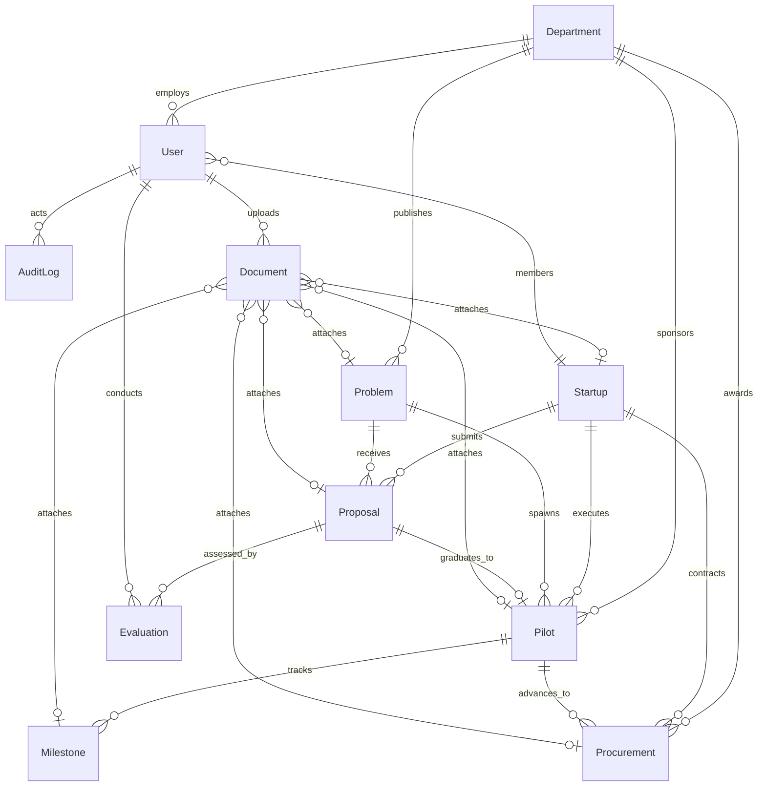

# Startexel Architecture & Database Design Specification (DESIGN.md)

## 1. Executive Summary

**Startexel** is an open, high-trust GovTech Innovation & Procurement Platform designed to streamline how public sector departments post challenges, evaluate emerging technology proposals from startups, manage phased pilot deployments, and transition validated solutions into formal public procurement contracts.

---

## 2. System Domain Model & Entity-Relationship Diagram

---

## 3. Core Database Tables (11 Entities)

### 3.1. `departments`
Represents municipal agencies, state departments, and federal ministries issuing challenges.
- **`id`** (`UUID`, Primary Key): Unique identifier.
- **`name`** (`VarChar(255)`, Unique): Official departmental title.
- **`code`** (`VarChar(50)`, Unique): Short institutional code (e.g., `MHI-HEALTH`, `DOT-MOBILITY`).
- **`description`** (`Text`): Mandate and responsibilities.
- **`website`** (`VarChar(255)`, Nullable): Public portal URL.
- **`contactEmail`** (`VarChar(255)`): Official correspondence email.
- **`contactPhone`** (`VarChar(50)`, Nullable): Contact phone number.
- **`location`** (`VarChar(255)`, Nullable): Headquarters / jurisdiction.
- **`status`** (`DepartmentStatus`, Default `ACTIVE`): `ACTIVE`, `INACTIVE`, `ARCHIVED`.
- **`createdAt`** / **`updatedAt`** (`Timestamp`): Standard auditing timestamps.

### 3.2. `startups`
Represents registered technology vendors, innovators, and research spin-offs.
- **`id`** (`UUID`, Primary Key): Unique identifier.
- **`name`** (`VarChar(255)`): Corporate or trade name.
- **`registrationNumber`** (`VarChar(100)`, Unique): Corporate registry or tax identifier (e.g., CIN / DPIIT number).
- **`description`** (`Text`): Overview of capabilities and domain.
- **`industry`** (`VarChar(100)`): Sector (e.g., AI/ML, CleanTech, MedTech, GovTech, CyberSecurity).
- **`stage`** (`StartupStage`, Default `EARLY_STAGE`): `IDEATION`, `EARLY_STAGE`, `GROWTH`, `SCALING`, `MATURE`.
- **`website`** (`VarChar(255)`, Nullable): Company homepage.
- **`foundedYear`** (`Int`, Nullable): Founding year.
- **`headquarters`** (`VarChar(255)`, Nullable): Operating city/country.
- **`teamSize`** (`Int`, Nullable): Number of full-time personnel.
- **`logoUrl`** (`VarChar(500)`, Nullable): Brand asset URL.
- **`verified`** (`Boolean`, Default `false`): Verification flag by platform administrator.
- **`createdAt`** / **`updatedAt`** (`Timestamp`).

### 3.3. `users`
Represents all authenticated actors with role-based access controls.
- **`id`** (`UUID`, Primary Key): Unique identifier.
- **`email`** (`VarChar(255)`, Unique): User login and notification address.
- **`passwordHash`** (`VarChar(255)`): Salted bcrypt password hash.
- **`firstName`** (`VarChar(100)`): First name.
- **`lastName`** (`VarChar(100)`): Last name.
- **`phoneNumber`** (`VarChar(50)`, Nullable): Mobile contact.
- **`role`** (`Role`): Core authorization role enum:
  - `ADMIN`: System superuser with complete oversight.
  - `DEPT`: Departmental administrator or challenge sponsor.
  - `STARTUP`: Founder or technical lead representing a startup.
  - `EVALUATOR`: Expert reviewing and scoring proposals.
  - `AUDITOR`: Independent compliance officer inspecting logs and procurement integrity.
- **`status`** (`UserStatus`, Default `ACTIVE`): `ACTIVE`, `INACTIVE`, `SUSPENDED`.
- **`departmentId`** (`UUID`, Nullable, FK -> `departments.id`): Associated department (for `DEPT` users).
- **`startupId`** (`UUID`, Nullable, FK -> `startups.id`): Associated startup (for `STARTUP` users).
- **`avatarUrl`** (`VarChar(500)`, Nullable): User portrait image URL.
- **`lastLoginAt`** (`Timestamp`, Nullable): Last authenticated timestamp.
- **`createdAt`** / **`updatedAt`** (`Timestamp`).

### 3.4. `problems`
Represents municipal, environmental, or public sector problem statements / challenges.
- **`id`** (`UUID`, Primary Key): Unique identifier.
- **`title`** (`VarChar(255)`): Problem title.
- **`slug`** (`VarChar(255)`, Unique): URL-friendly identifier.
- **`code`** (`VarChar(50)`, Unique): Reference tracking code (e.g., `PRB-2026-001`).
- **`description`** (`Text`): Detailed problem narrative, pain points, and current constraints.
- **`category`** (`VarChar(100)`): Challenge domain (e.g., Urban Mobility, Smart City, Water Management).
- **`severity`** (`ProblemSeverity`, Default `MEDIUM`): `LOW`, `MEDIUM`, `HIGH`, `CRITICAL`.
- **`status`** (`ProblemStatus`, Default `PUBLISHED`): `DRAFT`, `PUBLISHED`, `IN_REVIEW`, `PILOTING`, `RESOLVED`, `CLOSED`.
- **`departmentId`** (`UUID`, FK -> `departments.id`): Publishing department.
- **`createdById`** (`UUID`, FK -> `users.id`): Officer who authored the problem.
- **`budget`** (`Decimal(12, 2)`, Nullable): Allocated challenge / pilot budget.
- **`deadline`** (`Timestamp`, Nullable): Proposal submission cutoff date.
- **`eligibilityCriteria`** (`Text`, Nullable): Vendor prerequisites and compliance rules.
- **`expectedOutcomes`** (`Text`, Nullable): Measurable target deliverables.
- **`tags`** (`Text[]`): Array of keywords for categorization.
- **`embedding`** (`Unsupported("vector(384)")`, Nullable): 384-dimensional vector embedding for semantic search.
- **`createdAt`** / **`updatedAt`** (`Timestamp`).

### 3.5. `proposals`
Represents startup applications bidding to solve specific published problems.
- **`id`** (`UUID`, Primary Key): Unique identifier.
- **`code`** (`VarChar(50)`, Unique): Application code (e.g., `PROP-2026-001`).
- **`title`** (`VarChar(255)`): Proposed solution name.
- **`summary`** (`Text`): High-level executive summary.
- **`technicalApproach`** (`Text`): Architecture, technology stack, and implementation plan.
- **`budget`** (`Decimal(12, 2)`): Requested financial grant/fee.
- **`durationMonths`** (`Int`): Estimated implementation timeline in months.
- **`status`** (`ProposalStatus`, Default `SUBMITTED`): `DRAFT`, `SUBMITTED`, `UNDER_REVIEW`, `SHORTLISTED`, `ACCEPTED`, `REJECTED`, `WITHDRAWN`.
- **`problemId`** (`UUID`, FK -> `problems.id`): Problem being addressed.
- **`startupId`** (`UUID`, FK -> `startups.id`): Submitting company.
- **`submittedById`** (`UUID`, FK -> `users.id`): User who submitted the proposal.
- **`embedding`** (`Unsupported("vector(384)")`, Nullable): 384-dimensional vector embedding of solution summary for AI semantic matching.
- **`submittedAt`** (`Timestamp`, Default `now()`).
- **`createdAt`** / **`updatedAt`** (`Timestamp`).

### 3.6. `evaluations`
Multi-criteria evaluations scored by independent or departmental subject matter experts.
- **`id`** (`UUID`, Primary Key): Unique identifier.
- **`proposalId`** (`UUID`, FK -> `proposals.id`): Proposal under review.
- **`evaluatorId`** (`UUID`, FK -> `users.id`): Assigned expert evaluator.
- **`technicalScore`** (`Float`): Technical feasibility & innovation (0-100).
- **`feasibilityScore`** (`Float`): Operational readiness & execution risk (0-100).
- **`costScore`** (`Float`): Commercial competitiveness & value for money (0-100).
- **`impactScore`** (`Float`): Measurable public benefit (0-100).
- **`overallScore`** (`Float`): Weighted composite score.
- **`recommendation`** (`EvaluationRecommendation`): `STRONGLY_ACCEPT`, `ACCEPT`, `NEUTRAL`, `REJECT`, `STRONGLY_REJECT`.
- **`comments`** (`Text`): Evaluator review justification.
- **`criteriaFeedback`** (`JSONB`, Nullable): Granular rubrics and sub-criteria breakdown.
- **`status`** (`EvaluationStatus`, Default `SUBMITTED`): `DRAFT`, `SUBMITTED`, `FINALIZED`.
- **`submittedAt`** (`Timestamp`, Nullable).
- **`createdAt`** / **`updatedAt`** (`Timestamp`).

### 3.7. `pilots`
Real-world, small-scale deployments verifying the efficacy of accepted proposals.
- **`id`** (`UUID`, Primary Key): Unique identifier.
- **`code`** (`VarChar(50)`, Unique): Pilot tracking code (e.g., `PLT-2026-001`).
- **`title`** (`VarChar(255)`): Pilot project title.
- **`scope`** (`Text`): Boundaries, deployment environment, and trial criteria.
- **`status`** (`PilotStatus`, Default `INITIATED`): `INITIATED`, `IN_PROGRESS`, `PAUSED`, `COMPLETED`, `FAILED`, `GRADUATED`.
- **`startDate`** (`Timestamp`): Official commencement date.
- **`endDate`** (`Timestamp`): Scheduled conclusion date.
- **`actualEndDate`** (`Timestamp`, Nullable): Completion timestamp.
- **`allocatedBudget`** (`Decimal(12, 2)`): Budget allocated for trial.
- **`spentBudget`** (`Decimal(12, 2)`, Default `0.00`): Incurred expenses.
- **`kpiTargets`** (`JSONB`, Nullable): Target metrics (e.g., accuracy > 95%, latency < 200ms).
- **`kpiResults`** (`JSONB`, Nullable): Observed outcomes during the test run.
- **`departmentId`** (`UUID`, FK -> `departments.id`): Sponsoring department.
- **`startupId`** (`UUID`, FK -> `startups.id`): Executing vendor.
- **`problemId`** (`UUID`, FK -> `problems.id`): Original problem statement.
- **`proposalId`** (`UUID`, Unique, FK -> `proposals.id`): Selected proposal.
- **`managerId`** (`UUID`, Nullable, FK -> `users.id`): Departmental pilot manager.
- **`createdAt`** / **`updatedAt`** (`Timestamp`).

### 3.8. `milestones`
Phased checkpoints within a pilot project governing deliverables and fund disbursement.
- **`id`** (`UUID`, Primary Key): Unique identifier.
- **`pilotId`** (`UUID`, FK -> `pilots.id`): Parent pilot project.
- **`title`** (`VarChar(255)`): Milestone title (e.g., "Field Sensor Setup").
- **`description`** (`Text`): Work items and acceptance criteria.
- **`orderIndex`** (`Int`): Sequential execution order (1, 2, 3...).
- **`dueDate`** (`Timestamp`): Target completion deadline.
- **`completedDate`** (`Timestamp`, Nullable): Date verified.
- **`status`** (`MilestoneStatus`, Default `PENDING`): `PENDING`, `IN_PROGRESS`, `SUBMITTED`, `VERIFIED`, `REJECTED`, `DELAYED`.
- **`deliverables`** (`Text`, Nullable): Summary of submitted outputs.
- **`verificationCriteria`** (`Text`, Nullable): Inspection checklist.
- **`verificationFeedback`** (`Text`, Nullable): Review notes from the project manager.
- **`disbursementAmount`** (`Decimal(12, 2)`, Nullable): Milestone tranche payment.
- **`disbursementStatus`** (`DisbursementStatus`, Default `NOT_APPLICABLE`): `NOT_APPLICABLE`, `PENDING`, `APPROVED`, `DISBURSED`.
- **`createdAt`** / **`updatedAt`** (`Timestamp`).

### 3.9. `procurements`
Formal public procurement contracts awarded to startups upon graduating from a successful pilot.
- **`id`** (`UUID`, Primary Key): Unique identifier.
- **`contractNumber`** (`VarChar(100)`, Unique): Official government contract identifier (e.g., `PROC-2026-0089`).
- **`title`** (`VarChar(255)`): Contract title.
- **`description`** (`Text`): Scope of procurement and delivery terms.
- **`type`** (`ProcurementType`): `DIRECT_AWARD`, `INNOVATION_PARTNERSHIP`, `TENDER_FAST_TRACK`, `FRAMEWORK_AGREEMENT`.
- **`status`** (`ProcurementStatus`, Default `DRAFT`): `DRAFT`, `PENDING_APPROVAL`, `APPROVED`, `CONTRACT_SIGNED`, `FULFILLED`, `TERMINATED`.
- **`pilotId`** (`UUID`, Nullable, FK -> `pilots.id`): Originating pilot reference.
- **`departmentId`** (`UUID`, FK -> `departments.id`): Procuring department.
- **`startupId`** (`UUID`, FK -> `startups.id`): Awardee vendor.
- **`contractValue`** (`Decimal(14, 2)`): Total monetary value of contract.
- **`startDate`** (`Timestamp`): Contract execution start date.
- **`endDate`** (`Timestamp`): Contract term expiry date.
- **`termsAndConditions`** (`Text`, Nullable): Contractual clauses.
- **`approvalOfficer`** (`VarChar(255)`, Nullable): Name and title of signatory official.
- **`createdAt`** / **`updatedAt`** (`Timestamp`).

### 3.10. `documents`
Polymorphic document store tracking pitch decks, test reports, specifications, and contracts.
- **`id`** (`UUID`, Primary Key): Unique identifier.
- **`title`** (`VarChar(255)`): Human-readable file label.
- **`fileName`** (`VarChar(255)`): Original uploaded filename.
- **`fileSize`** (`Int`): Size in bytes.
- **`mimeType`** (`VarChar(100)`): MIME type (e.g., `application/pdf`).
- **`fileUrl`** (`VarChar(500)`): Object storage path (MinIO / S3 key).
- **`category`** (`DocumentCategory`): `PROPOSAL_PITCH`, `TECHNICAL_SPEC`, `FINANCIAL_REPORT`, `MILESTONE_PROOF`, `PILOT_EVALUATION`, `CONTRACT`, `COMPLIANCE`, `OTHER`.
- **`uploadedById`** (`UUID`, FK -> `users.id`): Uploader user reference.
- **Foreign Key Attachments** (all nullable):
  - `problemId` (FK -> `problems.id`)
  - `proposalId` (FK -> `proposals.id`)
  - `pilotId` (FK -> `pilots.id`)
  - `milestoneId` (FK -> `milestones.id`)
  - `procurementId` (FK -> `procurements.id`)
  - `startupId` (FK -> `startups.id`)
- **`createdAt`** / **`updatedAt`** (`Timestamp`).

### 3.11. `audit_logs`
Cryptographically secured, tamper-evident immutable log for tracking governance and high-stakes operations.
- **`id`** (`UUID`, Primary Key): Unique identifier.
- **`actor_id`** (`UUID`, Nullable, FK -> `users.id`): User who triggered the event.
- **`action`** (`VarChar(100)`): Event verb (e.g., `PROPOSAL_SUBMITTED`, `EVALUATION_FINALIZED`, `MILESTONE_VERIFIED`, `CONTRACT_SIGNED`).
- **`entity`** (`VarChar(100)`): Target entity type (`Proposal`, `Pilot`, `Procurement`, etc.).
- **`entity_id`** (`VarChar(100)`): Primary key of target entity.
- **`payload`** (`JSONB`): Full structured payload of the action or diff.
- **`prev_hash`** (`VarChar(64)`): SHA-256 hash of previous audit log row (`"GENESIS"` for initial record).
- **`hash`** (`VarChar(64)`): Current block SHA-256 hash computed over `(prev_hash + actor_id + action + entity + entity_id + payload + created_at)`.
- **`created_at`** (`Timestamp`, Default `now()`): Creation timestamp.
- **Index**: Dedicated B-Tree index on `created_at` for high-speed chronological auditing.
- **Immutability Contract**: Strictly append-only; updates and deletions are programmatically and structurally disallowed.

---

## 4. Vector Embeddings Specification (`pgvector`)

Startexel enables semantic matching between unstructured problem statements and startup proposals using dense vector embeddings:
- **Embedding Dimensions**: `384` (compatible with `sentence-transformers/all-MiniLM-L6-v2` and `bge-small-en-v1.5`).
- **Postgres Column Type**: `vector(384)` via PostgreSQL extension `vector`.
- **Prisma Representation**: `embedding Unsupported("vector(384)")?`.
- **First Migration Requirement**: Includes `CREATE EXTENSION IF NOT EXISTS vector;` prior to table creation.
- **Distance Metrics**: Cosine distance (`<=>`) or Inner Product (`<#>`) via raw queries in NestJS.

---

## 5. Security & Password Strategy

- User passwords are encrypted with `bcrypt` (10 rounds).
- Demo credentials for all roles are seeded deterministically with secure, documented passwords for development testing.
